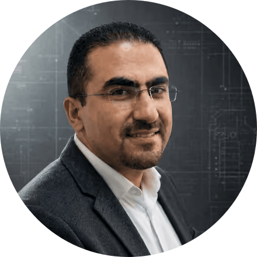

# Bashar Ayyash | AI Systems Architect & Tech Lead

I build production AI systems for regulated industries and ship full-stack web and mobile products with Laravel, Next.js, and React Native.

**Amman, Jordan · Yabasha on GitHub**

I started building software professionally in 2005. At EJADA I led banking web and mobile delivery. Before that, I built humanitarian data platforms and led a team working on research reporting and geospatial software. My AI work focuses on Arabic and English retrieval, evaluation design, and deciding what an AI system can do before a person needs to step in.

[Experience](experience/README.md) · [Case studies](case-studies/README.md) · [How I work](how-i-work.md) · [Releases](https://github.com/yabasha/living-cv/releases) · [GitHub profile](https://github.com/yabasha)

## Selected work

- **Banking and mobile delivery.** I led the squad that shipped a marketplace inside a React Native digital wallet, coordinating the mobile app and its commerce integration. [EJADA role and projects](experience/ejada.md)
- **AI for regulated workflows.** I worked on bilingual retrieval and agent architecture. My banking write-up explains what goes behind a Laravel queue, what evidence reviewers need, and why people retain release and compliance decisions. [Banking AI case study](case-studies/banking-ai.md)
- **AI in my own product.** I built the queued Laravel job that fills missing SEO fields for my Next.js portfolio. It preserves existing field values and falls back to the article text when a model response fails. [Portfolio AI case study](case-studies/portfolio-ai.md)
- **Humanitarian and research data.** I built commodity-price reporting tools for the Syria response and led a five-person iMMAP team contributing to CGIAR's research platform and land-management GIS. [iMMAP role and projects](experience/immap.md)

## How I work

I start with one workflow the team can prove end to end. Before choosing a model, I ask what evidence a reviewer needs, which actions need approval, and how we'll catch a regression. I build a small working slice and review it with the people who will use or run it. [Read how I scope, test, and ship](how-i-work.md).

## Stack

`RAG` · `AI evaluations` · `AI security` · `Laravel` · `Next.js` · `React Native` · `TypeScript` · `Python` · `PostgreSQL` · `Redis`

[Changelog](CHANGELOG.md) · [Suggest a correction](https://github.com/yabasha/living-cv/issues/new/choose)
