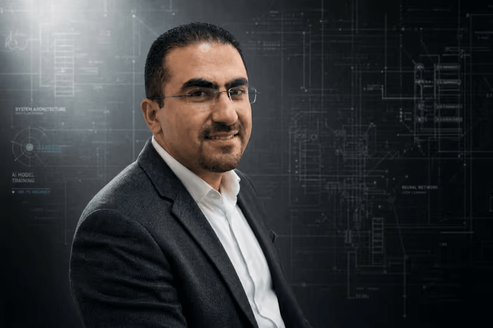

# Bashar Ayyash | AI Systems Architect & Tech Lead

I build production AI systems for regulated industries and ship full-stack web and mobile products with Laravel, Next.js, and React Native.

**Amman, Jordan**

I bring 20 years of enterprise software experience across fintech, humanitarian information management, and web and mobile products. I design retrieval-augmented generation (RAG) systems and AI agents, with evaluations, AI security, and monitoring built into delivery.

[Experience](experience/README.md) · [Case studies](case-studies/README.md) · [Releases](https://github.com/yabasha/living-cv/releases) · [GitHub profile](https://github.com/yabasha)

## Selected work

- **Regulated fintech.** At [EJADA](experience/ejada.md), I led delivery for banking web and mobile applications. I also build bilingual retrieval systems and AI agents designed for human review. [Read the banking AI case study](case-studies/banking-ai.md).
- **Humanitarian and research platforms.** At [iMMAP](experience/immap.md), I built data collection and reporting tools and led a team contributing to CGIAR’s research platform and a web GIS for land management. [Read the MEL and GeOC case study](case-studies/mel-geoc.md).

## Stack

`RAG` · `AI evaluations` · `AI security` · `Laravel` · `PHP` · `Next.js` · `React` · `TypeScript` · `React Native` · `Python`

[Changelog](CHANGELOG.md) · [Suggest a correction](https://github.com/yabasha/living-cv/issues/new/choose)
